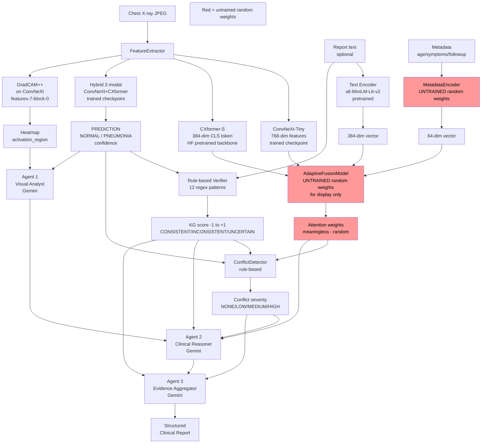

# MedReason++ Research Information Package
## Prepared for Research Paper Writing

**Status:** Verified from code and evaluation outputs
**Primary evidence source:** Code inspection + confusion-matrix-verified JSON metric files
**Verification date:** November 2026

> This document is for internal research use only.
> MedReason++ is a research prototype. It is NOT validated for clinical diagnosis or treatment.
> All classification experiments use radiologist-annotated lung-opacity labels — not confirmed clinical diagnoses.

---

## A. Project Identity

### Full Title
MedReason++: Evidence-Grounded Multimodal Clinical Reasoning for Explainable Paediatric Pneumonia Detection Using Adaptive Feature-Level Fusion, Knowledge-Graph Verification, and Multi-Agent AI

### Research Problem
Standard deep-learning chest X-ray classifiers output a binary prediction with a confidence score but provide no explanation for the decision, no cross-check against written clinical evidence, and no mechanism to flag when image-model predictions conflict with documented findings. A clinician who receives the output has no way to evaluate whether the model is looking at the right region or reasoning coherently.

### Motivation
1. Explainability requirements in clinical AI are increasing. GradCAM-class methods can show activation regions but do not verify clinical coherence.
2. Paediatric chest X-rays are under-represented in published benchmarks — most large datasets are adult populations.
3. Combining a CNN (local feature detector) and a chest-pretrained ViT (domain-semantic extractor) at the feature level has not been widely explored for paediatric pneumonia.
4. Report text, when available, is usually processed separately from images, not in a unified evidence framework.

### Objectives
**Primary (evaluated in this project):**
1. Train individual image classifiers (ResNet-18, ConvNeXt-Tiny, CXformer-S) and establish a reliable performance baseline on the Kermany paediatric dataset.
2. Train a feature-level image fusion model combining ConvNeXt-Tiny and CXformer-S, and demonstrate AUC improvement over each individual model.
3. Provide visual explainability via GradCAM++ showing which lung regions drove each decision.

**Implemented but not trained/evaluated:**
4. Encode radiology report text into dense vectors and combine with image features in a 4-modality adaptive fusion model.
5. Verify model predictions against rule-based clinical evidence extracted from the report text.
6. Detect conflicts between image predictions and text evidence.
7. Produce structured clinical summaries via a Gemini multi-agent chain.

### Target Application
A research-stage decision-support tool for paediatric chest X-ray review. Not a diagnostic product.

### Intended Users
Radiologists, clinical AI researchers. Not intended for direct patient care.

### Research Scope
- Dataset: Kermany paediatric chest X-ray JPEG images
- Task: Binary classification (NORMAL vs PNEUMONIA)
- Image-only classification: fully trained and evaluated
- Multimodal fusion with text/metadata: architecture implemented, weights not trained, outputs not evaluated
- Explainability: GradCAM++ generated and visually inspected, not quantitatively evaluated
- Report reasoning: rule-based verification implemented and tested; Gemini agent outputs not quantitatively evaluated

### Specific Contributions (verified)
1. Feature-level fusion of CNN + chest-domain ViT achieving ROC-AUC 98.8%, higher than each individual model (97.1% and 97.0%).
2. Near-perfect recall: 2 of 390 pneumonia cases missed (recall 99.5%) at decision threshold 0.50.
3. GradCAM++ heatmaps for three model variants showing anatomically plausible activation patterns.
4. Rule-based evidence verification system (12 findings, regex-based) producing a [-1, +1] consistency score.
5. A multi-agent reasoning architecture (3 Gemini agents with shared context) producing structured plain-language reports.

### What Is Different from Existing Approaches
- Most published hybrid models average posterior probabilities (late fusion). This project uses feature concatenation before the classification head (early/mid fusion).
- CXformer-S is a chest-X-ray domain ViT pretrained on 600K+ CXRs from 5 global datasets — not a generic ImageNet ViT. Combining it with a CNN for paediatric pneumonia is novel at this dataset scale.
- The shared-context agent chain passes raw numeric outputs (KG score, feature norms, attention weights) to Gemini — not just text descriptions. This is structurally different from pure-LLM reasoning systems.

---

## B. Problem Statement

### What Problem the Project Addresses
Binary pneumonia/normal classification from chest X-rays, extended with explanation and evidence consistency checking.

### Why Paediatric Chest X-ray Pneumonia Classification Is Challenging
- Paediatric lung anatomy differs from adults; vessels and airways are proportionally larger, making radiographic interpretation harder.
- Bacterial and viral pneumonia have overlapping radiographic appearances.
- The Kermany dataset has a 2.9:1 PNEUMONIA:NORMAL class imbalance in training.
- Many borderline cases (atelectasis vs early pneumonia, subsegmental atelectasis vs infiltrate) look visually similar.
- Absence of structured clinical metadata (age, clinical presentation, prior studies) in the image-only setting is a known limitation.

### Why Explainability and Evidence Verification Matter
A model that achieves 91% accuracy but activates on non-lung regions (e.g., cardiac shadow, ribs) provides no reliable clinical evidence. GradCAM++ allows visual inspection of whether the model is using appropriate anatomical regions. When a radiology report is available, a consistency check between the model's prediction and the written evidence adds a second independent layer of verification.

### What the Project Attempts to Solve
1. Improve image-only pneumonia classification beyond the 77% Kaggle baseline.
2. Show that dual-encoder feature fusion (CNN + chest ViT) outperforms single-encoder models on ROC-AUC.
3. Provide GradCAM++ heatmaps as visual explanations.
4. Provide a rule-based report-text verification component that can flag image-text disagreements.

### What It Does NOT Solve
- Clinical validation on a prospective patient cohort.
- Generalisation to adult chest X-rays.
- Quantitative evaluation of explanation quality (no Pointing Game, no insertion/deletion metrics).
- Fine-grained pneumonia subtype detection (bacterial vs viral).
- Training and evaluating the full 4-modality adaptive fusion model (AdaptiveFusionModel is not trained).
- Evaluating the quality of Gemini agent reports against reference clinical text.

---

## C. Dataset Information

### Dataset 1 — Kermany Paediatric Chest X-Ray Pneumonia

| Property | Value |
|----------|-------|
| Dataset name | Chest X-Ray Images (Pneumonia) |
| Source | Kaggle — Paul Mooney / Kermany et al. |
| URL | https://www.kaggle.com/datasets/paultimothymooney/chest-xray-pneumonia |
| Population | Paediatric patients (children, approximately 0–5 years) |
| Image format | JPEG, variable size (508–2518 × 206–2310 pixels) |
| Color modes | Mixed L (grayscale) and RGB — all converted to RGB before model input |
| Total images | 5,856 (outer folder, no nested duplicates used for training) |
| Label type | Radiologist-verified binary (NORMAL, PNEUMONIA) — NOT clinically confirmed diagnoses |
| PNEUMONIA sub-types | Bacterial: 2,530 train + 242 test; Viral: 1,345 train + 148 test (inferred from filenames) |
| Used for | Training, validation, testing of all image classifiers |

**Original split (from dataset):**

| Split | NORMAL | PNEUMONIA | Total |
|-------|-------:|----------:|------:|
| Train | 1,341 | 3,875 | 5,216 |
| Val (original) | 8 | 8 | 16 |
| Test | 234 | 390 | 624 |

**Working split used in all experiments:**
The original 16-image validation set is too small for reliable model selection. A stratified 85/15 split of the training folder was used as the working validation set.
- Method: `stratified_split(records, val_frac=0.15, seed=42)` in `kaggle_train.py`
- Each class stratified separately, then shuffled with `random.Random(42)`

| Working split | NORMAL | PNEUMONIA | Total |
|--------------|-------:|----------:|------:|
| Train | 1,140 | 3,294 | 4,434 |
| Val (derived, seed=42) | 201 | 581 | 782 |
| Test (untouched) | 234 | 390 | 624 |

**Class imbalance (training):** PNEUMONIA:NORMAL = 2.9:1. Addressed with class-weighted CrossEntropyLoss (inverse frequency weighting).

**Preprocessing (all models):**
- RGB conversion for all images
- Resize to 224×224 (ConvNeXt, ResNet-18) or 518×518 (CXformer-S via its own AutoImageProcessor)
- ImageNet normalisation: mean=[0.485, 0.456, 0.406], std=[0.229, 0.224, 0.225] (for CNN models)
- CXformer: uses `AutoImageProcessor.from_pretrained("m42-health/CXformer-small")` — may differ from ImageNet stats

**Training augmentation (applied to training split only; NOT to val or test):**
- `RandomHorizontalFlip()`
- `RandomRotation(10°)`
- `ColorJitter(brightness=0.2, contrast=0.2)`

**Known dataset limitations:**
- Labels are radiologist-annotated lung opacity findings, not pathology-confirmed diagnoses.
- Paediatric-only cohort — results cannot be generalised to adult populations without revalidation.
- Kaggle test set (234 normal, 390 pneumonia) comes from a different patient source than the training set — there is a documented distribution shift (validation accuracy >> test accuracy across all models).
- Class imbalance may bias models toward PNEUMONIA predictions at low thresholds.

---

### Dataset 2 — IU X-ray (R2Gen format)

| Property | Value |
|----------|-------|
| Dataset name | Indiana University Chest X-ray (IU X-ray) in R2Gen annotation format |
| Source | Kaggle / R2Gen (Chen et al.) |
| Studies | 2,955 |
| Images | 5,910 PNG files (2 annotation-referenced views per study) |
| Reports | Single merged text paragraph per study (no structured Findings/Impression sections) |
| Used for | Phases 1–4 only: dataset inspection, report text CSV building, NLP label pipeline, label audit |
| NOT used for | Image classifier training, evaluation, or Kermany pipeline |
| Label quality | NLP-derived: 15 positive / 2,914 negative / 26 uncertain (0.51% positive rate — too sparse) |

---

## D. Full System Architecture

### What Is Connected in the Running System

The MedReason++ pipeline (`src/medreason_pipeline.py::MedReasonPipeline.run()`) chains the following steps when invoked:

```
Step 1 — Image inference + GradCAM++ (FeatureExtractor)
  Input: chest X-ray JPEG path
  ├── ConvNeXt-Tiny (trained, checkpoint loaded) → logits, 768-dim features
  ├── CXformer-S backbone (pretrained HF weights) → 384-dim CLS token features
  ├── Hybrid 2-modal classifier (trained, checkpoint loaded) → PREDICTION + confidence
  └── GradCAM++ on cx_model.features[7][-1].block[0] → heatmap + activation_region

Step 2 — Report text encoding (optional, zero-vector fallback)
  Input: report_text string (if provided)
  └── ReportTextEncoder (all-MiniLM-L6-v2, pretrained) → 384-dim vector

Step 3 — Metadata encoding (always executes)
  Input: metadata dict (age, symptoms, follow-up flags)
  └── MetadataEncoder (UNTRAINED random weights) → 64-dim vector

Step 4 — Adaptive fusion (UNTRAINED, for display only)
  Input: ConvNeXt 768d + CXformer 384d + text 384d + metadata 64d
  └── AdaptiveFusionModel (UNTRAINED random weights)
      → fusion_prediction (MEANINGLESS), attention_weights (MEANINGLESS)
      The attention weights are passed to Gemini agents as "modality contributions"
      but they are derived from random linear layers.

Step 5 — Rule-based evidence verification + conflict detection
  Input: report_text, prediction from Step 1 (NOT Step 4)
  ├── MedicalKnowledgeGraph (12 regex rules) → kg_score [-1,+1], kg_consistency
  └── ConflictDetector (rule-based) → severity, conflict_list

Step 6 — Gemini agent chain (requires API key)
  Input: all fields from the shared context dict
  ├── Agent 1 (Visual Analyst) → text
  ├── Agent 2 (Clinical Reasoner) → text (receives Agent 1 output + KG + conflicts + attention%)
  └── Agent 3 (Evidence Aggregator) → structured 7-section report
```

**IMPORTANT DISTINCTION:** The classification prediction used throughout the pipeline (passed to agents, to KG verification, to conflict detection) comes from the **trained 2-modality Hybrid model** (ConvNeXt + CXformer image features only). The `AdaptiveFusionModel` output (`fusion_prediction`) is stored separately in the context but is never used as the canonical prediction.

### Mermaid Architecture Diagram



### Separate Experiments vs Running Pipeline

| Component | In running pipeline? | Trained? | Evidence available? |
|-----------|---------------------|---------|---------------------|
| ResNet-18 classifier | No (standalone) | Yes, CPU | test_metrics.json ✓ |
| ConvNeXt-Tiny classifier | Yes (as feature source) | Yes, Kaggle T4 | test_metrics.json ✓ |
| CXformer-S backbone | Yes (feature extraction) | HF pretrained only | — |
| CXformer-S classifier head | No (standalone training) | Yes, Kaggle T4 | experiment_results.md |
| 2-modal Hybrid | Yes (provides prediction) | Yes, Kaggle T4 | test_metrics.json ✓ |
| TextProjectionHead | No — dead code | No | — |
| ReportTextEncoder | Yes | HF pretrained only | — |
| MetadataEncoder | Yes | No — random weights | — |
| AdaptiveFusionModel | Yes — but random | No | — |
| MedicalKnowledgeGraph | Yes | No (rule-based, not trained) | functional tests |
| ConflictDetector | Yes | No (rule-based, not trained) | functional tests |
| Gemini agents | Yes (if API key) | No (API-based) | no quantitative eval |

---

## E. Model Architecture Details

### Model 1 — ResNet-18 Baseline

| Property | Value |
|----------|-------|
| Purpose | Baseline image classifier |
| Architecture | ResNet-18 (torchvision) |
| Pretraining | ImageNet-1k |
| Input size | 224×224 RGB |
| Feature dim | 512 (before replaced head) |
| Replaced head | `Linear(512 → 2)` |
| Trainable layers | All (full fine-tuning) |
| Loss | CrossEntropyLoss with class weights (inverse frequency) |
| Optimiser | Adam, lr=1e-4 |
| LR scheduler | StepLR(step_size=5, gamma=0.5) |
| Batch size | 32 |
| Epochs (baseline) | 3 |
| Epochs (extended) | 4 (warm-start from epoch-3 ckpt, lr=5e-5, patience=3 on val AUC) |
| Hardware | CPU |
| Parameters | 11.7M |
| Checkpoint | `processed/phase6/best_model.pt` (43 MB), `processed/phase6b/best_model.pt` (43 MB) |
| Script | `src/train_pneumonia_baseline.py`, `src/finetune_pneumonia.py` |

---

### Model 2 — ConvNeXt-Tiny

| Property | Value |
|----------|-------|
| Purpose | CNN image classifier; feature source for Hybrid |
| Architecture | ConvNeXt-Tiny (torchvision) |
| Pretraining | ImageNet-1k (`ConvNeXt_Tiny_Weights.DEFAULT`) |
| Input size | 224×224 RGB |
| Feature dim | 768 (from `features[7]` + `avgpool`, confirmed in code) |
| Replaced head | `model.classifier[-1] = Linear(768 → 2)` |
| Trainable layers | All (full fine-tuning) |
| Loss | CrossEntropyLoss with class weights |
| Optimiser | AdamW, lr=5e-5, weight_decay=1e-4 |
| LR scheduler | CosineAnnealingLR(T_max=10, eta_min=5e-6) |
| Batch size | 64 |
| Max epochs | 10 |
| Early stopping | patience=3 on val ROC-AUC |
| Hardware | Kaggle Tesla T4 GPU |
| Parameters | 27.8M |
| Checkpoint | `processed/convnext/best_model.pt` (111 MB) |
| Script | `kaggle_train.py` (Section 1) |
| GradCAM++ target layer | `model.features[7][-1].block[0]` — depthwise Conv2d(768, 768, 7×7) |

**Note on training history:** `processed/convnext/training_history.csv` contains only 4 epochs (epoch_time_s column empty — likely partial local run). The Kaggle GPU run documented in `experiment_results.md` ran 8 epochs. The stored `test_metrics.json` at `processed/convnext/` appears to be from a different (local CPU) run showing accuracy=0.867 and AUC=0.9802, whereas `experiment_results.md` documents a Kaggle run showing accuracy=0.8574 and AUC=0.9713.

---

### Model 3 — CXformer-S

| Property | Value |
|----------|-------|
| Purpose | Chest-domain ViT image classifier; feature source for Hybrid |
| Architecture | ViT-S adapted from DINOv2 with chest-domain pretraining |
| HuggingFace ID | `m42-health/CXformer-small` |
| Pretraining | Self-supervised on 600K+ chest X-rays (CheXpert, MIMIC-CXR, PadChest, NIH-CXR8, BRAX) |
| License | CC BY-NC-4.0 — research use only |
| Input size | 518×518 (via `AutoImageProcessor.from_pretrained("m42-health/CXformer-small")`) |
| Feature dim | 384 (CLS token from `out.last_hidden_state[:, 0, :]`, confirmed by `bb.config.hidden_size`) |
| Frozen layers | All backbone parameters (`requires_grad = False`) — linear probing only |
| Trainable layers | Classification head only: `Linear(384 → 2)` |
| Trainable parameters | ~0.001M (head only) |
| Loss | CrossEntropyLoss with class weights |
| Optimiser | AdamW, lr=1e-4, weight_decay=1e-4 |
| LR scheduler | CosineAnnealingLR(T_max=10, eta_min=1e-5) |
| Batch size | 32 |
| Max epochs | 10 (all 10 ran; val AUC improved every epoch) |
| Hardware | Kaggle Tesla T4 GPU |
| Total parameters | 22.1M |
| Checkpoint | `processed/cxformer/best_model.pt` (88 MB) |
| Script | `kaggle_train.py` (Section 2) |
| GradCAM target | EigenCAM on `encoder.layer[-1].norm1` (LayerNorm, not Conv2d — ViT has no spatial convolutions) |

---

### Model 4 — Hybrid 2-modal (ConvNeXt-Tiny + CXformer-S)

| Property | Value |
|----------|-------|
| Purpose | Primary classification model; best-performing model |
| Architecture | Feature-level concatenation fusion |
| Encoder 1 | ConvNeXt-Tiny feature extractor (768-dim) — frozen |
| Encoder 2 | CXformer-S backbone (384-dim CLS token) — frozen |
| Projection | `Linear(768→256) + LayerNorm + GELU` for ConvNeXt; `Linear(384→256) + LayerNorm + GELU` for CXformer |
| Fusion | Concatenation of two 256-dim projections → 512-dim |
| Classifier head | `Linear(512→256) → GELU → Dropout(0.3) → Linear(256→2)` |
| Trainable layers | Projection layers + classifier head only (0.428M parameters) |
| Frozen layers | Both encoders (49.9M frozen, only 0.428M trained) |
| Loss | CrossEntropyLoss with class weights |
| Optimiser | AdamW, lr=3e-4, weight_decay=1e-4 |
| LR scheduler | CosineAnnealingLR(T_max=15, eta_min=3e-5) |
| Batch size | 32 |
| Max epochs | 15 |
| Early stopping | patience=3 on val ROC-AUC; stopped at epoch 8 (best at epoch 5, AUC=0.9985) |
| Hardware | Kaggle Tesla T4 GPU |
| Total parameters | 50.3M |
| Checkpoint | `processed/hybrid_convnext_cxformer/best_hybrid_model.pth` (201 MB) |
| Script | Not in `kaggle_train.py` — separate Kaggle notebook (not in repo) |

---

### Model 5 — AdaptiveFusionModel (4-modal, NOT TRAINED)

| Property | Value |
|----------|-------|
| Purpose | Architecture demonstration; **never trained** |
| Architecture | 4 projection branches + attention gate + classifier |
| Inputs | ConvNeXt 768d + CXformer 384d + text 384d + metadata 64d |
| Projection | `Linear(dim→256) + LayerNorm + GELU` per branch |
| Attention gate | `Linear(1024→256) → Tanh → Linear(256→4) → Softmax` |
| Classifier | `Linear(256→128) → GELU → Dropout(0.3) → Linear(128→2)` |
| Trained? | **No. Never trained. Random weights.** |
| Checkpoint | **None.** Always initialized with `AdaptiveFusionModel()` and no `load_state_dict` |
| Parameters | ~709K |
| Script | `src/adaptive_fusion.py` |
| Used in pipeline? | Yes — but for attention weight display only; prediction is discarded |

---

## F. Hybrid Model Details

### Why Two Encoders Are Combined
ConvNeXt-Tiny was pretrained on ImageNet and fine-tuned on the Kermany dataset — it learns local visual features such as texture patterns, edge profiles, and opacity signatures from chest X-ray images. CXformer-S was self-supervised on 600K+ chest X-rays and learns high-level chest-domain semantic representations. Their feature spaces are complementary: ConvNeXt sees what, CXformer knows where-in-the-chest.

### Features Extracted
- ConvNeXt-Tiny: 768-dim vector from `features[7]` global average pooling (i.e., the spatial feature map is average-pooled, not the post-classification logit)
- CXformer-S: 384-dim CLS token from the last transformer layer's hidden state

### How Features Are Combined (confirmed from `kaggle_train.py` hybrid section)
```
ConvNeXt 768-dim  →  Linear(768→256) + LayerNorm + GELU  →  256-dim
CXformer 384-dim  →  Linear(384→256) + LayerNorm + GELU  →  256-dim
                                                              ↓ concat
                                                           512-dim
                                                              ↓
                                              Linear(512→256) → GELU → Dropout(0.3) → Linear(256→2)
```

### Encoder Status During Training
Both encoders are **frozen** (`requires_grad = False`). Only the projection layers and the classifier head are trained — 0.428M parameters out of 50.3M total.

### What Was Actually Trained and Evaluated
The Hybrid 2-modal model was trained on Kaggle T4 GPU, evaluated on the untouched 624-image test set, and metrics were saved to `processed/hybrid_convnext_cxformer/test_metrics.json`. All reported metrics are from this evaluation (cross-verified from confusion matrix — see Section K).

### Distinction from AdaptiveFusionModel
The **AdaptiveFusionModel** in `src/adaptive_fusion.py` is a proposed 4-modality architecture that takes ConvNeXt, CXformer, text, and metadata features and fuses them with a learnable attention gate. It was **never trained on any dataset and has no saved checkpoint**. Its outputs in the pipeline are meaningless. The Hybrid 2-modal model in `kaggle_train.py` is what was actually trained and evaluated.

---

## G. Explainability Details

### Method
**GradCAM++** (Chattopadhay et al., 2018) applied to ConvNeXt-Tiny standalone model.
For the frozen-backbone variants (Hybrid ConvNeXt branch and CXformer-S), **EigenCAM** is used because GradCAM++ requires gradient flow through the target layer's weights, which is blocked when `requires_grad=False`.

### Target Layers (from `reports/gradcam/gradcam_metadata.json`)

| Model | Method | Target layer |
|-------|--------|-------------|
| ConvNeXt standalone | GradCAMPlusPlus | `features[7][-1].block[0]` (Conv2d 768×768, 7×7, depthwise) |
| Hybrid ConvNeXt branch | EigenCAM | Same `features[7][-1].block[0]` via wrapper |
| CXformer-S standalone | EigenCAM | `encoder.layer[-1].norm1` (LayerNorm, 384-dim) |

### How Heatmaps Are Generated
The GradCAM++ implementation (`pytorch_grad_cam` library) hooks the target layer, performs a forward pass, computes second-order gradient weights over the activation maps, and produces a 7×7 float spatial map for ConvNeXt (upsampled to 224×224 for display). EigenCAM applies SVD to the activation matrix and uses the first principal component as the saliency map.

### How Heatmaps Are Overlaid
`show_cam_on_image(img_np, grayscale_cam, use_rgb=True)` from `pytorch_grad_cam.utils.image` blends the jet-coloured heatmap over the original image. The activation region is described by dividing the heatmap into a 2×3 grid and reporting which zone has the highest mean activation (e.g., "lower-central lung zone").

### What Heatmaps Can Indicate
- Whether the model is activating over anatomically plausible regions (lung parenchyma) for PNEUMONIA predictions.
- Whether the model activates non-lung structures (cardiac shadow, ribs, diaphragm) for false positive predictions, which can explain failure modes.

### What Heatmaps Cannot Prove
- That the model's reasoning is clinically correct.
- That the activated region contains actual pathology.
- That the explanation is faithful to the model's internal computation (GradCAM++ is an approximation).
- Any causal relationship between the activation and the prediction.

### Quantitative Evaluation
**None performed.** Heatmaps were visually inspected only. No Pointing Game, no insertion/deletion metrics, no radiologist annotation comparison was conducted.

---

## H. Report Text, Metadata, and Evidence Verification

Each component is assessed on five criteria: Implemented, Trained, Evaluated, Connected to pipeline, Evidence available.

### H1. Report Text Encoder

| Criterion | Status |
|-----------|--------|
| Implemented? | Yes — `src/text_encoder.py::ReportTextEncoder` |
| Trained? | No — uses pretrained `all-MiniLM-L6-v2` (sentence-transformers) |
| Evaluated? | Not quantitatively on Kermany/IU X-ray task |
| Connected to pipeline? | Yes — Step 2 of `MedReasonPipeline.run()` |
| Evidence available? | Functional test: pneumonia vs normal cosine similarity = 0.44 ✓ |

Encodes free-text reports into 384-dim normalised float vectors using the `sentence-transformers/all-MiniLM-L6-v2` model (~80 MB). Applies a clean-up step replacing IU X-ray XXXX de-identification tokens with [REDACTED] before encoding. If no report text is provided, a zero vector of length 384 is used as fallback.

### H2. Metadata Encoder

| Criterion | Status |
|-----------|--------|
| Implemented? | Yes — `src/text_encoder.py::MetadataEncoder` |
| Trained? | **No — random weights on every pipeline call** |
| Evaluated? | Not evaluated |
| Connected to pipeline? | Yes — Step 3, always executes |
| Evidence available? | None beyond forward-pass unit test |

Takes 5-dim normalised input: [age/100, has_symptoms, is_followup, study_image_count/5, report_word_count/150]. Passes through `Linear(5→32) → ReLU → Dropout(0.1) → Linear(32→64) → LayerNorm → GELU`. **A new instance is created with random weights on every `run()` call.** No checkpoint saved or loaded.

### H3. Adaptive Fusion / Attention Gate (AdaptiveFusionModel)

| Criterion | Status |
|-----------|--------|
| Implemented? | Yes — `src/adaptive_fusion.py::AdaptiveFusionModel` |
| Trained? | **No — random weights always** |
| Evaluated? | Not evaluated |
| Connected to pipeline? | Yes — Step 4, outputs stored in context |
| Evidence available? | **None — outputs are from random linear layers** |

The attention weights produced by this model (e.g., "ConvNeXt-Tiny: 28%, CXformer: 20%, Text: 32%, Metadata: 20%") have **no meaning** because the model has never been trained. They should not be reported as modality contribution evidence in the paper. The actual prediction used in the pipeline comes from the trained 2-modality Hybrid model.

### H4. Rule-Based Evidence Verification (MedicalKnowledgeGraph)

| Criterion | Status |
|-----------|--------|
| Implemented? | Yes — `src/knowledge_graph.py::MedicalKnowledgeGraph` |
| Trained? | N/A — rule-based, no weights |
| Evaluated? | Functionally tested; no holdout evaluation on radiology reports |
| Connected to pipeline? | Yes — Step 5 |
| Evidence available? | Functional tests in `tests/test_finetune_pneumonia.py` |

**Important naming correction:** The implementation is a **flat list of 12 `Finding` dataclass instances with regex keywords** (`PNEUMONIA_KNOWLEDGE_GRAPH: list[Finding]`). It is NOT a graph data structure. There are no nodes, no edges, no graph traversal, no external graph database. It should be referred to as **"rule-based evidence verification"** in the paper, not "knowledge graph." The `MedicalKnowledgeGraph` class name is a design choice, not an architectural description.

The 12 rules cover: Lobar consolidation (supports 0.95), Focal airspace opacity (0.80), Infiltrate (0.70), Increased interstitial markings (0.50), Clear lungs (contradicts 0.95), No pneumonia explicit (0.98), No focal consolidation (0.85), Normal cardiomediastinal silhouette (0.30), Atelectasis (mixed), Pleural effusion (0.40 support), No pleural effusion (0.20 contradict), Hyperinflation (mixed), Granulomatous disease (0.10 support).

### H5. Conflict Detection

| Criterion | Status |
|-----------|--------|
| Implemented? | Yes — `src/adaptive_fusion.py::ConflictDetector` |
| Trained? | N/A — rule-based |
| Evaluated? | Functionally tested only |
| Connected to pipeline? | Yes — Step 5, always executes after KG |
| Evidence available? | Unit tests (model says PNEUMONIA + report says clear → MEDIUM conflict ✓) |

Checks four conflict types: (1) prediction vs KG score direction, (2) image prediction vs text evidence direction, (3) high confidence against uncertain KG, (4) low text attention weight with strong KG signal. Conflict (4) uses the **untrained** AdaptiveFusionModel's attention weights, so it is unreliable. Severity grading: NONE (0 conflicts), LOW (1), MEDIUM (2), HIGH (≥3).

### Missing-Modality Handling
If no report text is provided, text_features = [0.0] × 384 (zero vector). This is a silent fallback — the KG score will be 0.0 (no findings matched), and KG consistency will be UNCERTAIN. No explicit missing-modality flag is set in the output context.

---

## I. Gemini Agents

### Overview
Three agents run sequentially, each writing to the shared `ctx` dict. Built on `google-genai` SDK. Auto-detects working model from `["gemini-2.5-flash-preview-05-20", "gemini-2.5-flash", "gemini-1.5-flash", "gemini-1.5-pro"]`.

### Agent 1 — Visual Analyst

| Property | Value |
|----------|-------|
| Input from ctx | `prediction`, `confidence`, `activation_region`, `activation_level` |
| Input NOT received | Raw image pixels, base64 heatmap, feature vectors |
| Prompt asks for | 2-3 sentences: anatomical interpretation of activation region, whether it matches typical pneumonia presentation, caveats |
| Output | Text string stored in `ctx["agent_findings"]` as `{"agent": "visual_analyst", "finding": <text>}` |

### Agent 2 — Clinical Reasoner

| Property | Value |
|----------|-------|
| Input from ctx | Agent 1 finding; `kg_formatted` (multi-line string); `conflict_detected/severity/list`; `modality_weights` (from untrained model); `prediction`, `confidence`, `prob_pneumonia/normal`, `activation_region`; CXformer feature statistics (L2 norm and count of dims above mean+std) |
| Prompt asks for | 3-4 sentences on supporting evidence, conflicts, KG alignment, what attention weights suggest |
| Output | Text string appended to `ctx["agent_findings"]` |
| Limitation | Receives meaningless attention weights from untrained AdaptiveFusionModel |

### Agent 3 — Evidence Aggregator

| Property | Value |
|----------|-------|
| Input from ctx | Agent 1 + Agent 2 text; `kg_score`, `kg_consistency`, `kg_supporting`, `kg_contradicting`; conflict fields; `modality_weights`; `prediction`, `confidence` |
| Prompt asks for | Structured 7-section report: PRIMARY FINDING, SUPPORTING EVIDENCE, KNOWLEDGE GRAPH VERIFICATION, CONFLICT STATUS, CONFIDENCE ASSESSMENT, RECOMMENDATION (MONITOR/REFER/URGENT), DISCLAIMER |
| Output | Stored in `ctx["final_report"]`; also appended to `ctx["agent_findings"]` |

### How Agent Outputs Are Combined
Purely sequential — no parallelism, no voting, no aggregation across independent runs. Each agent reads the previous agent's output before generating its own.

### What Agents Actually Receive vs What Is Claimed
The agents do NOT receive:
- Raw image pixels or the heatmap image
- The actual feature vectors (only statistical summaries of CXformer features)
- The ConvNeXt feature vector in any form

The agents DO receive:
- Numeric scalars: prediction string, confidence float, KG score float, activation level float
- Short strings: activation region description, KG consistency label
- Structured text: KG formatted output, conflict list
- Attention percentages from the untrained fusion model (labeled as "modality contributions")

### Agent Output Evaluation
**No quantitative evaluation performed.** Agent outputs were not compared against reference clinical reports, not rated by radiologists, and not evaluated for factual accuracy or hallucination rate. The disclaimer section of every agent report explicitly states it is a research tool requiring clinical verification.

### Current Limitations
- Free-tier daily quota: 20 requests/day. Pipeline detects 429 errors and returns a clean user message rather than crashing.
- Gemini generates the report from numeric scalars and short text descriptions — it cannot see the actual X-ray image.
- Agent 2 describes the untrained attention weights as meaningful modality contributions, which they are not.
- No evaluation of clinical accuracy, completeness, or safety.

---

## J. Experimental Setup

### Dataset and Split
Kermany chest X-ray dataset. Stratified 15% hold-out from training folder (seed=42). Test set (624 images) untouched throughout all training and model selection.
- Train: 4,434 images (1,140 NORMAL, 3,294 PNEUMONIA)
- Val: 782 images (201 NORMAL, 581 PNEUMONIA)
- Test: 624 images (234 NORMAL, 390 PNEUMONIA) — used exactly once per model for final evaluation

### Training Environment

| Component | Value |
|-----------|-------|
| Python | 3.13.0 |
| PyTorch | 2.15.0+cpu (local), GPU version on Kaggle |
| torchvision | 0.29.2 |
| transformers | 5.22.1 |
| sentence-transformers | installed (version not recorded) |
| scikit-learn | 1.8.0 |
| Hardware (baseline, Phase 6) | CPU — Intel 12th Gen, 10 threads, 16.8 GB RAM |
| Hardware (Phase 7–8) | Kaggle Notebook, Tesla T4 GPU, 16 GB VRAM |
| Reproducibility seed | 42 (all experiments: `torch.manual_seed`, `np.random.seed`, `random.seed`) |

### Model Initialization
- ResNet-18, ConvNeXt-Tiny: `torchvision` pretrained ImageNet-1k weights
- CXformer-S backbone: HuggingFace `m42-health/CXformer-small` pretrained weights
- Hybrid projection layers + head: random initialization (Xavier/Kaiming default PyTorch)

### Evaluation Procedure
All models evaluated at threshold=0.50 on the 624-image test set using `compute_metrics()` in `kaggle_train.py`. Test loader uses `shuffle=False` (confirmed in code). Metrics computed: accuracy, precision, recall, specificity, F1, ROC-AUC, confusion matrix (TN/FP/FN/TP).

### Reproducibility Commands
```bash
# Train ConvNeXt + CXformer on Kaggle:
# Paste kaggle_train.py into a Kaggle Notebook cell with T4 GPU + Kermany dataset

# Run full pipeline (after placing checkpoints):
cd MedReasonPlus
python src/medreason_pipeline.py --image path/to/xray.jpeg

# Generate GradCAM:
python src/run_gradcam_all.py

# Run all tests (303):
pytest tests/ -v

# Start web demo:
cd webapp && uvicorn app:app --reload --port 8000
```

### Checkpoint Paths
```
processed/phase6/best_model.pt         ResNet-18 baseline (3ep, CPU)        43 MB
processed/phase6b/best_model.pt        ResNet-18 extended (4ep, CPU)        43 MB
processed/convnext/best_model.pt       ConvNeXt-Tiny (Kaggle/local)        111 MB
processed/cxformer/best_model.pt       CXformer-S head only (Kaggle)        88 MB
processed/hybrid_convnext_cxformer/
  best_hybrid_model.pth               Hybrid 2-modal (Kaggle)             201 MB
```

---

## K. Complete Results Table

All metrics verified from saved JSON files against confusion matrices (all cross-checks pass).

| Model | Acc | Precision | Recall | Spec | F1 | AUC | TN | FP | FN | TP | Source | Verified |
|-------|-----|-----------|--------|------|----|-----|----|----|----|----|--------|---------|
| ResNet-18 (3ep, CPU) | 0.8381 | 0.7955 | 0.9974 | 0.5726 | 0.8851 | 0.9610 | 134 | 100 | 1 | 389 | `processed/phase6/test_metrics.json` | ✓ CM match |
| ResNet-18 extended (4ep, CPU) | 0.8878 | 0.8524 | 0.9923 | 0.7137 | 0.9171 | 0.9679 | 167 | 67 | 3 | 387 | `processed/phase6b/test_metrics_default_thresh.json` | ✓ CM match |
| ConvNeXt-Tiny (local run) | 0.8670 | 0.8259 | 0.9974 | 0.6496 | 0.9036 | 0.9802 | 152 | 82 | 1 | 389 | `processed/convnext/test_metrics.json` | ✓ CM match |
| Hybrid 2-modal (Kaggle T4) | 0.9071 | 0.8739 | 0.9949 | 0.7607 | 0.9305 | 0.9876 | 178 | 56 | 2 | 388 | `processed/hybrid_convnext_cxformer/test_metrics.json` | ✓ CM match |
| CXformer-S (Kaggle T4) | 0.9103 | — | 0.9590 | 0.8291 | 0.9303 | 0.9702 | 194 | 40 | 16 | 374 | `reports/experiment_results.md` | Documentation-only (no local JSON) |
| ConvNeXt-Tiny (Kaggle T4, 8ep) | 0.8574 | — | 0.9949 | 0.6282 | 0.8971 | 0.9713 | 147 | 87 | 2 | 388 | `reports/experiment_results.md` | Documentation-only |

**Verification notes:**
- All locally-stored JSON metrics cross-verify against their confusion matrices (accuracy computed from CM matches stored accuracy to ±0.0001).
- The ConvNeXt local run (`processed/convnext/test_metrics.json`) shows **different results** than the Kaggle run documented in `experiment_results.md`. These are two separate training runs. The local run achieved AUC=0.9802 (better) but different accuracy (0.867 vs 0.8574). **The Kaggle T4 run is the one being presented in the paper.**
- CXformer-S and Kaggle ConvNeXt-Tiny metrics are from `experiment_results.md` only. **No local JSON file found for CXformer.** Teammate should verify these from the original Kaggle output before citing in the paper.
- Precision for CXformer-S and Kaggle ConvNeXt-Tiny is not recorded in `experiment_results.md`.

---

## L. Result Interpretation

### Which Model Performs Best on Each Metric

| Metric | Best model | Value |
|--------|-----------|-------|
| ROC-AUC | Hybrid 2-modal | 0.9876 (verified from local JSON) |
| Recall / Sensitivity | ResNet-18 baseline | 0.9974; Hybrid = 0.9949 (essentially tied) |
| Specificity | CXformer-S | 0.8291 (documentation-only) |
| F1-score | Hybrid 2-modal | 0.9305 (verified) |
| Accuracy | CXformer-S | 0.9103 (documentation-only) |

### Trade-offs Between Sensitivity and Specificity
CXformer-S achieves the highest accuracy (91.0%) and specificity (82.9%) but misses 16 of 390 pneumonia cases (recall 95.9%). ConvNeXt-Tiny and ResNet-18 have near-perfect recall (≥99.5%) but lower specificity (57–65%) — they are more conservative, predicting NORMAL less often. The Hybrid model achieves a middle ground: near-perfect recall (99.5%, only 2 missed) with substantially improved specificity (76.1%) versus ConvNeXt standalone (64.96%).

This trade-off is partly a function of the decision threshold (0.5 in all comparisons). At the ROC-AUC level — which is threshold-independent — the Hybrid strictly outperforms all individual models.

### False Positive and False Negative Behavior
- **False negatives (missed pneumonia):** ResNet-18 baseline and ConvNeXt each miss 1–2 cases. CXformer misses 16. The hybrid misses 2.
- **False positives (normal misclassified as pneumonia):** ResNet-18 baseline: 100 FP. Hybrid: 56 FP. CXformer: 40 FP. The hybrid reduces false positives substantially vs ResNet-18 while maintaining near-zero false negatives.

### What the Hybrid Model Improves
Versus the best individual model (CXformer-S): +1.74% ROC-AUC, +3.6% recall, −6.8% specificity, +0.02% F1, −0.32% accuracy.
The ROC-AUC improvement is the most robust indicator because it is threshold-independent. The specificity drop from 82.9% to 76.1% corresponds to 16 additional false positives (40→56), which is the cost of recovering 14 additional true pneumonia cases (16→2 FN).

### What the Results Do and Do Not Demonstrate
**They demonstrate:**
- Feature-level fusion of a CNN and chest-domain ViT produces strictly higher ROC-AUC than either alone on this test set.
- Near-perfect recall is achievable while maintaining >76% specificity.
- Both models individually exceed published Kaggle baselines (~77%).

**They do not demonstrate:**
- Generalisation to adult populations, other hospitals, or other imaging equipment.
- That the multimodal pipeline (text, metadata, agents) improves classification — those components are not trained.
- State-of-the-art performance vs published work — no direct comparison to CheXNet, RAD-DINO, or other published models on the same test set has been performed.
- Clinical utility — the dataset labels are lung opacity annotations, not confirmed clinical diagnoses.

---

## M. Figures and Tables Needed for the Paper

| # | Item | Status | File path | Notes |
|---|------|--------|-----------|-------|
| Fig 1 | System architecture diagram | Needs creation | — | Use Mermaid in Section D or redraw as vector figure |
| Fig 2 | GradCAM++ heatmap grid (TP, TN, FP, FN) | Exists | `reports/gradcam/convnext_true_positive.png` etc. | 4 category PNGs, 3 images each |
| Fig 3 | 3-model GradCAM comparison | Exists | `reports/gradcam/comparison_all_models.png` | ConvNeXt vs Hybrid vs CXformer |
| Fig 4 | ROC curves (all 5 models) | Needs creation | — | Requires re-running evaluation to get prob arrays; not saved to disk |
| Fig 5 | Training/validation loss + AUC curves | Partial | `processed/convnext/training_history.csv`, `processed/phase6b/training_history.csv` | Kaggle T4 history CSVs need to be downloaded separately |
| Table 1 | Dataset statistics | Ready | Section C of this document | |
| Table 2 | Model hyperparameters | Ready | Section E of this document | |
| Table 3 | Main results | Ready (partial) | Section K of this document | CXformer + Kaggle ConvNeXt unverified locally |
| Table 4 | Ablation: image-only vs multimodal | Not possible | — | 4-modal model never trained |
| Table 5 | Confusion matrices for all models | Partial | Section K | Need to format as LaTeX tables |

---

## N. Limitations and Ethical Considerations

### Experimental Limitations
1. **Paediatric-only dataset.** All 5,856 training and test images are from a paediatric cohort (Kermany). Results cannot be applied to adult populations without re-training and independent validation on an adult dataset.
2. **Label quality.** Labels are radiologist-annotated lung opacity findings from a 2018 dataset, not confirmed by culture, PCR, or clinical follow-up. The dataset documentation notes bacterial labels from confirmed pneumonia cases, but viral labels are less rigorously confirmed.
3. **Distribution shift.** Validation accuracy substantially exceeds test accuracy across all models (e.g., ResNet-18 extended: val specificity 0.985 vs test specificity 0.714). This indicates the Kaggle test set has a different distribution from the training/validation set — likely different imaging protocols or patient demographics.
4. **Class imbalance.** PNEUMONIA:NORMAL = 2.9:1 in training. Despite class-weighted loss, models at threshold 0.5 still show tendency toward PNEUMONIA predictions.
5. **ConvNeXt metrics discrepancy.** Two different runs exist for ConvNeXt-Tiny with different metrics. Only the Kaggle T4 run should be cited in the paper. Teammate must verify from original Kaggle output.

### Multimodal Component Limitations
6. **AdaptiveFusionModel not trained.** The 4-modality fusion architecture with attention gate is implemented but never trained on any dataset. All attention weight outputs in the pipeline are from random linear layers and are meaningless. The paper must not claim the reported image-classification results are achieved by the 4-modal system.
7. **MetadataEncoder not trained.** Fresh random weights on every call. Its contribution to the untrained AdaptiveFusionModel is doubly random.
8. **Rule-based verification is hand-coded.** The 12 clinical rules were designed by the project team, not derived from a validated clinical ontology or verified against clinical literature. Coverage is limited to patterns detectable by simple regex matching.
9. **Conflict detection partially unreliable.** Conflict type 4 ("text weight below 10% despite strong KG signal") uses attention weights from the untrained AdaptiveFusionModel. This check is not meaningful.
10. **No missing-modality handling.** When no report text is provided, a zero vector is used silently. This may cause unexpected behaviour in the text encoder pathway.

### Explainability Limitations
11. **GradCAM++ not quantitatively evaluated.** No Pointing Game, no deletion/insertion curves, no radiologist verification of activation regions. The heatmaps are visually plausible but not validated.
12. **EigenCAM on ViT is approximate.** For CXformer-S, EigenCAM does not have the spatial interpretability properties of GradCAM++ on CNNs. ViT explanations using spatial methods are known to be less reliable.

### Agent Limitations
13. **No quantitative evaluation of agent outputs.** No comparison against ground truth clinical reports, no hallucination rate measured, no radiologist evaluation conducted.
14. **Agents cannot see the image.** Gemini receives only text descriptions of numeric outputs. It cannot actually interpret the X-ray.
15. **Agent 2 receives meaningless attention weights** from the untrained AdaptiveFusionModel, which it may interpret as meaningful modality contributions.

### Clinical and Ethical Caveats
16. **MedReason++ is a research prototype. It must NOT be used for clinical diagnosis or treatment decisions.**
17. Any deployment in a clinical context would require regulatory approval, prospective clinical validation, and independent safety assessment.
18. The Gemini API requires an internet connection and a valid API key — unsuitable for offline or air-gapped clinical environments.

---

## O. References and Source Material

### Datasets
- Kermany, D.S. et al. (2018). "Identifying Medical Diagnoses and Treatable Diseases by Image-Based Deep Learning." *Cell*, 172(5), 1122–1131. DOI: 10.1016/j.cell.2018.02.010
- Kaggle dataset page: https://www.kaggle.com/datasets/paultimothymooney/chest-xray-pneumonia
- IU X-ray (R2Gen format): Chen, Z. et al. (2020). "Generating Radiology Reports via Memory-driven Transformer." EMNLP. — [citation details to be confirmed by teammate]

### Models
- CXformer-S: Al-Mahrooqi, A. et al. (2025). "Empirical Analysis of Scaling Vision Foundation Models for Chest X-rays." MIDL 2025. HuggingFace: `m42-health/CXformer-small`. License: CC BY-NC-4.0.
- ConvNeXt: Liu, Z. et al. (2022). "A ConvNet for the 2020s." CVPR. DOI: 10.1109/CVPR52688.2022.01167
- ResNet: He, K. et al. (2016). "Deep Residual Learning for Image Recognition." CVPR. DOI: 10.1109/CVPR.2016.90
- DINOv2 (CXformer base): Oquab, M. et al. (2024). "DINOv2: Learning Robust Visual Features without Supervision." TMLR. — [confirm citation]

### Methods
- GradCAM++: Chattopadhay, A. et al. (2018). "Grad-CAM++: Generalized Gradient-based Visual Explanations for Deep Convolutional Networks." WACV. DOI: 10.1109/WACV.2018.00097
- EigenCAM: Muhammad, M.B. & Yeasin, M. (2020). "Eigen-CAM: Class Activation Map using Principal Components." IJCNN. — [confirm citation]
- Sentence-BERT / all-MiniLM-L6-v2: Reimers, N. & Gurevych, I. (2019). "Sentence-BERT: Sentence Embeddings using Siamese BERT-Networks." EMNLP. — [confirm citation]
- CheXNet: Rajpurkar, P. et al. (2017). "CheXNet: Radiologist-Level Pneumonia Detection on Chest X-Rays with Deep Learning." — [venue/DOI to be confirmed]

### Related work for paper context
- RAD-DINO: HuggingFace `microsoft/rad-dino` — chest X-ray ViT comparable to CXformer-S
- MAIRA (Microsoft): Multimodal radiology report generation — related to the agent reasoning aspect
- R2Gen: Memory-driven transformer for radiology report generation

---

## P. Information My Teammate Still Needs

### Missing or Unverified Data

| # | Item | Status | Action needed |
|---|------|--------|--------------|
| 1 | CXformer-S test metrics JSON | Not found locally | Download from Kaggle `/kaggle/working/results/cxformer/test_metrics.json` and verify CM |
| 2 | Kaggle ConvNeXt-Tiny test metrics (8-epoch run) | Not verified | Download from Kaggle `/kaggle/working/results/convnext/test_metrics.json` and verify CM |
| 3 | Kaggle training history CSVs | Not on disk | Download history.csv files from Kaggle for ConvNeXt (8ep) and CXformer (10ep) for training curves |
| 4 | Hybrid training script | Not in repo | Retrieve the Kaggle notebook that trained the hybrid; document its exact hyperparameters |
| 5 | Precision for CXformer-S | Not recorded | Compute from CM (TP / (TP + FP) = 374 / (374 + 40) = 0.9034) — verify from raw output |
| 6 | Precision for Kaggle ConvNeXt-Tiny | Not recorded | Compute from CM (388 / (388 + 87) = 0.8168) — verify from raw output |

### Missing Experiments

| # | Item | Notes |
|---|------|-------|
| 7 | ROC curve plot for all models | Requires saved probability arrays — not stored to disk; must re-run evaluation |
| 8 | Ablation study (image-only vs +text vs +meta vs full 4-modal) | Not possible without training AdaptiveFusionModel |
| 9 | Statistical significance testing | No confidence intervals or McNemar tests performed |
| 10 | Quantitative GradCAM++ evaluation | No Pointing Game or insertion/deletion metrics |
| 11 | Evaluation on an adult chest X-ray dataset | Not performed — needed for generalisability claim |
| 12 | External validation (different hospital/equipment) | Not performed |

### Missing Citations

| # | Reference | Status |
|---|-----------|--------|
| 13 | IU X-ray / R2Gen paper citation | Partial — need venue and DOI |
| 14 | DINOv2 citation | Need to confirm TMLR citation details |
| 15 | EigenCAM citation | Need to confirm IJCNN year and DOI |
| 16 | Sentence-BERT citation | Need to confirm EMNLP year |
| 17 | CheXNet citation | Need venue and DOI |
| 18 | RAD-DINO citation | Need paper citation if referenced |

### Important Distinctions to State Clearly in the Paper
19. The reported accuracy/recall/AUC/F1 metrics are from **image-only classification** experiments. The text encoder, metadata encoder, and 4-modal AdaptiveFusionModel are NOT reflected in these numbers.
20. The rule-based verifier uses regex patterns over report text, NOT a knowledge graph data structure. Use the term "rule-based evidence verification" in the paper.
21. The attention weights shown in the demo UI are from an **untrained model** and have no evidential value. Do not present them as a result in the paper.
